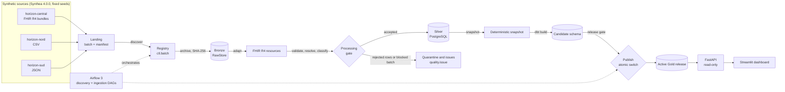

# HealthLake

> **HealthLake is a technical demonstration using synthetic data only.
> It is not a certified healthcare platform and is not intended or
> authorized to process real personal health data.**

HealthLake is a local analytics platform for **synthetic** healthcare data. Three fictional hospital sources
deliver batches in three formats (FHIR R4 bundles, CSV, JSON). HealthLake checks each batch, archives it
unchanged, converts it to FHIR R4, validates it, resolves references, and loads a historised Silver layer in
PostgreSQL. It then builds an analytical Gold model with dbt in a **candidate schema** and publishes it
**atomically** only after a quality gate passes. A read-only API and a dashboard serve the published release.
Airflow 3 orchestrates the whole pipeline.

The data is generated by [Synthea](https://github.com/synthetichealth/synthea) 4.0.0 with fixed seeds, so the
same revision always produces byte-identical batches.

## Contents
- [What it demonstrates](#what-it-demonstrates)
- [Architecture](#architecture)
- [Quick start](#quick-start)
- [Demonstration scenarios](#demonstration-scenarios)
- [Repository layout](#repository-layout)
- [Tests and verification](#tests-and-verification)
- [Performance](#performance)
- [Security](#security)
- [Known limits](#known-limits)
- [Documentation map](#documentation-map)
- [Licence](#licence)

## What it demonstrates
| Concern | How HealthLake handles it |
|---|---|
| Ingestion contract | Each batch carries a manifest listing files with SHA-256 and sizes. Batches are immutable; a hash mismatch blocks the batch. |
| Bronze | Content-addressed RawStore: each file is stored once under its SHA-256 and re-hashed on read and on restore. |
| Heterogeneous sources | Adapters turn CSV and JSON into FHIR R4 resources; every output resource keeps its lineage to the source row. |
| Validation | Two tiers: blocking structural checks on every resource, plus an official HL7 validator audit on a sample ([ADR 0003](architecture/adr/0003-validation-tiers.md)). |
| References | Resolved within each source's own namespace (no cross-source identity merge). Unresolved references are quarantined or block the batch, depending on the field. |
| Silver | Historised resource versions with deterministic ids. Every resource occurrence lands in exactly one outcome: accepted, out of scope, deduplicated or rejected. Reconciliation is checked. |
| Gold | dbt project: 5 dimensions, 6 facts, 6 aggregates and 100 data tests, built in a candidate schema per release. |
| Publication | Release gate (dbt tests plus release checks), then one atomic pointer switch. A failed gate leaves the active release untouched. |
| Recovery | Every step is idempotent, and an advisory lock serialises concurrent attempts. Crash points 1-7 are tested, including a hard kill. |
| Orchestration | Airflow 3.3 with two DAGs: discovery and ingestion. Data errors fail fast; transient errors retry with backoff. |
| Serving | FastAPI, read-only. API keys stored as hashes with scopes. Keyset pagination with signed cursors pinned to a release. |
| Dashboard | Streamlit, 6 pages, reads the API only (never the database). |
| Operations | Structured JSON logs with secret redaction, Prometheus metrics, 10 runbooks, verified backup and restore. |

## Architecture

More diagrams (batch lifecycle, record outcomes, release lifecycle, DAGs, deployment, identifiers, ERD) are in
[docs/architecture.md](docs/architecture.md).

**Stack:** Python 3.12, PostgreSQL 17 (tests also run on 16), dbt-core 1.12 with dbt-postgres, Airflow 3.3
(LocalExecutor), FastAPI, Streamlit, Synthea 4.0.0, HL7 FHIR validator 7.0.1, and Docker Compose. Every version
is pinned: images by digest, Python packages by hash, jars and the JRE by SHA-256, CI actions by commit.

## Quick start
Requirements: Docker Desktop or Docker Engine with Compose v2.20+, about 6 GB of memory for Docker, about 15 GB
of free disk, and Python 3.9+ on the host (standard library only) for the helper scripts.

```bash
python scripts/bootstrap.py      # checks prerequisites, creates .secrets/ and .env (no secret is printed)
docker compose build             # platform (Airflow + HealthLake + dbt + Java), api, dashboard
docker compose up -d
python scripts/wait_ready.py     # waits for one-shot init jobs and every health check
python scripts/demo.py --scenario happy-path
```
Then open:
- dashboard: http://127.0.0.1:8501
- API docs: http://127.0.0.1:8000/docs
- Airflow: http://127.0.0.1:8080

Credentials are in `.secrets/`, and bootstrap tells you which file holds which credential. `make down` stops the
stack and keeps the data. `make reset` deletes this project's volumes, after you confirm.

> **Verification status.** The Docker images and the Compose stack are written and `docker compose config`
> validates. They have **not** been built or started yet: the development sandbox has no Docker daemon. Every
> component *was* run for real outside containers: the CLI pipeline, dbt, Airflow 3.3 with a LocalExecutor on
> PostgreSQL, the API under uvicorn, and the dashboard in Chromium. See [Tests and verification](#tests-and-verification).

## Demonstration scenarios
`scripts/demo.py` runs each scenario on the real system and checks its expected outcome:

| Scenario | What happens | Expected result |
|---|---|---|
| `happy-path` | Generate 3 batches, run the ingestion DAG, build and publish a release | Release published; API and dashboard serve it |
| `quarantine` | A new horizon-nord revision with 120 new observations, one with a non-numeric value | That row is quarantined and reported by `/v1/quality`; the rest is published (reject rate under 1 %) |
| `idempotent-replay` | Ingest an already loaded batch again | Same release id, no duplicated resource |
| `blocked-publication` | (1) A CSV batch with a renamed header; (2) a release whose dbt tests fail (explicit demo fault injection) | Batch blocked without retry; failed gate; publication refused; active release unchanged |
| `recovery` | Crash injected during the Silver load, then a normal re-run | Both attempts recorded; the re-run loads once and the batch is published |

## Repository layout
```
src/healthlake/        Python package: CLI, ingestion, adapters, validation, Silver, release, API
dbt/                   Gold model (staging, intermediate, marts), seeds, tests
airflow/dags/          healthlake_discovery, healthlake_ingestion
dashboards/            Streamlit app (API client only)
infrastructure/        Dockerfiles, PostgreSQL migrations (0001-0009) and init scripts
config/                sources, profiles, Synthea properties, artifact lock, quality catalogue
scripts/               bootstrap, wait_ready, demo, backup, restore, performance measurement
tests/                 unit, integration, recovery, fhir, api, airflow, dashboard
docs/                  contract, API, runbooks, performance, test report, portfolio material
architecture/adr/      architecture decision records
```

## Tests and verification
Totals at the last full run: **81 tests in the app environment, 12 in the Airflow environment and 10 in the
dashboard environment, all passing**, plus 100 dbt data tests in every release build. The five demo
scenarios pass on the demo profile. ruff, ruff format and mypy `--strict` are clean. The suites include:
- the section 19.1 data cases (duplicates, conflicts, invalid updates, unresolved references and others);
- crash points 1-7, a hard kill, and concurrent attempts on the same batch;
- release tests with real dbt builds;
- a real HL7 validator run;
- API security and pagination tests;
- DAG contract tests;
- dashboard rendering tests on recorded API responses.

The full report, with commands and what is **not** verified, is in [docs/test-report.md](docs/test-report.md).

## Performance
Measured on a 2-vCPU, 7 GB development VM, without Docker:

| Profile | Resources | Generation | Pipeline (cold) | Database | API p95, 5 clients (warm) |
|---|---|---|---|---|---|
| demo (100 patients per source) | 160 111 | 205 s | 239 s | 0.9 GB | 68 ms aggregates, 76 ms lists |
| extended (1 000 patients per source) | 1 791 707 | 1 271 s | 1 841 s | 10.6 GB | 68 ms aggregates, 76 ms lists |

The extended run found three defects, all fixed and measured again:
- generation ran out of memory;
- the API had no Gold indexes (p95 about 1 s before the fix);
- the snapshot was slow (200 s, now 50 s).

The protocol, the per-step times and the analysis are in
[docs/performance/README.md](docs/performance/README.md).

## Security
- Synthetic data only; no real personal data may be introduced.
- Secrets live in `.secrets/`, outside Git. They are mounted at `/run/secrets` and read through `*_FILE`
  variables. `.env.example` holds no secret.
- Separate PostgreSQL roles for ingestion, dbt, publication, the API and operations. The API runs read-only
  sessions with a statement timeout.
- API keys are stored as SHA-256 hashes and compared in constant time; pagination cursors are HMAC-signed.
- Containers run as non-root with read-only root filesystems where possible, and ports bind to 127.0.0.1 only.
- CI runs gitleaks, pip-audit and Trivy.

See [SECURITY.md](SECURITY.md).

## Known limits
- The Compose stack, the images and PostgreSQL 17 are not verified on a Docker host yet (see above).
- HL7 validation of every resource is too slow for a laptop. The full set gets structural validation; the
  official validator audits a sample.
- Terminology is checked for code presence and system, not against a terminology server.
- A MedicationRequest that refers to a Medication delivered in an *earlier* batch is not coded from it.
- Swagger UI (`/docs`) loads its assets from a CDN (FastAPI default); `/openapi.json` works offline.
- Single-node, local deployment. No high availability, no multi-tenant isolation, no certified security.

The full list is in [docs/known-limits.md](docs/known-limits.md).

## Documentation map
| Topic | Document |
|---|---|
| Data contract, identifiers, outcomes | [docs/data-contract.md](docs/data-contract.md) |
| Architecture diagrams, data dictionary | [docs/architecture.md](docs/architecture.md), [docs/data-dictionary.md](docs/data-dictionary.md) |
| Decisions | [architecture/adr/](architecture/adr/), [docs/decisions.md](docs/decisions.md) |
| API | [docs/api/README.md](docs/api/README.md), [docs/api/openapi.json](docs/api/openapi.json) |
| Dashboard | [docs/dashboard.md](docs/dashboard.md) |
| Quality checks | [docs/quality-catalog.md](docs/quality-catalog.md) |
| Observability | [docs/observability.md](docs/observability.md) |
| Deployment | [docs/deployment.md](docs/deployment.md) |
| Runbooks | [docs/runbooks/](docs/runbooks/README.md) |
| Backup and restore | [docs/restore-report.md](docs/restore-report.md) |
| Tests, performance | [docs/test-report.md](docs/test-report.md), [docs/performance/README.md](docs/performance/README.md) |
| Portfolio (demo script, talk, CV, interview) | [docs/portfolio/](docs/portfolio/README.md) |
| Final report (French) | [docs/rapport-final.md](docs/rapport-final.md) |

## Licence
Apache License 2.0; see [LICENSE](LICENSE) and [NOTICE](NOTICE). Synthea and the HL7 validator are used as
external tools under their own licences and are not redistributed in this repository.
