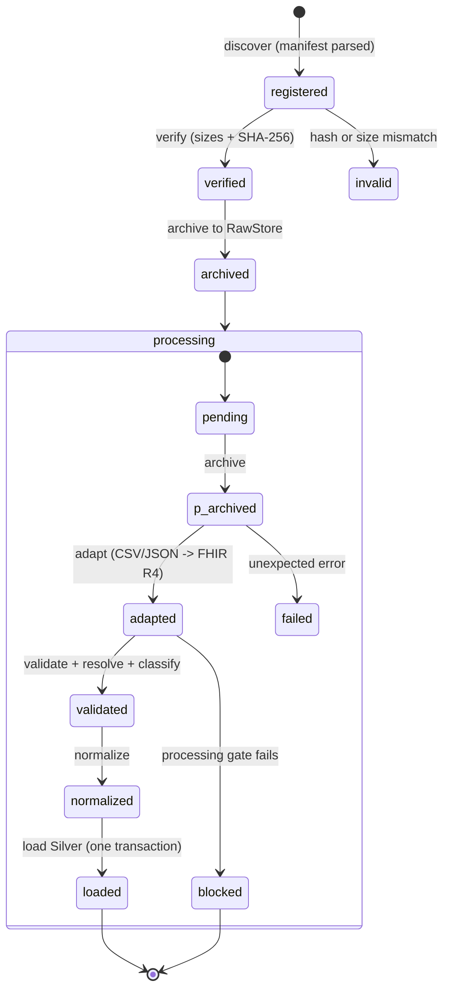
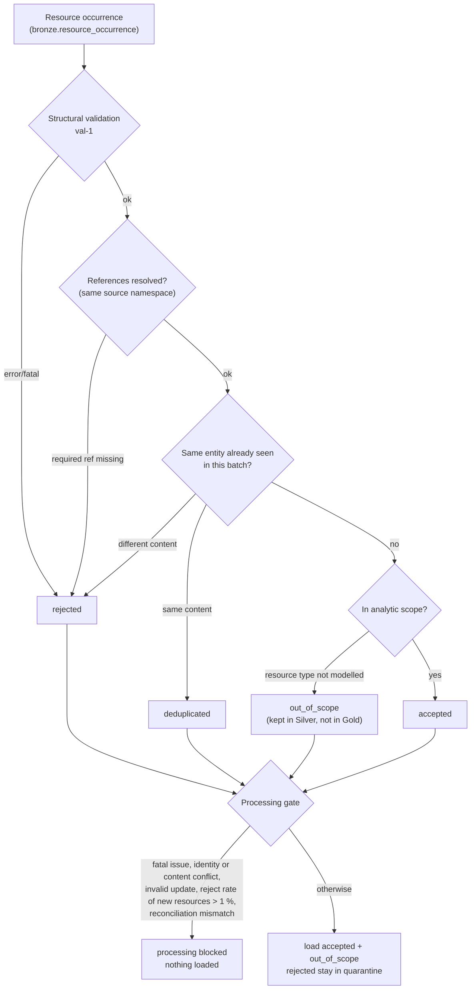
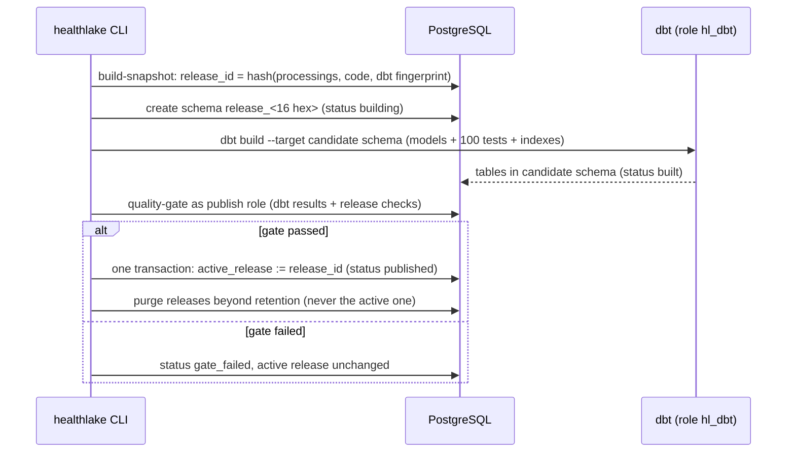
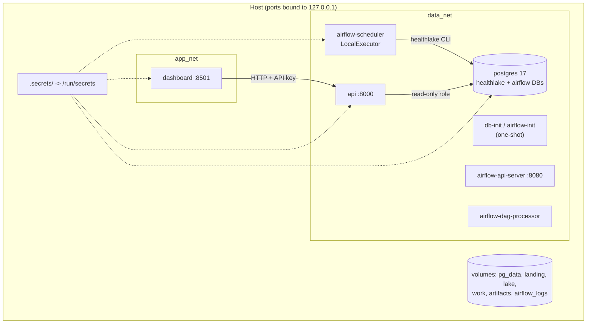
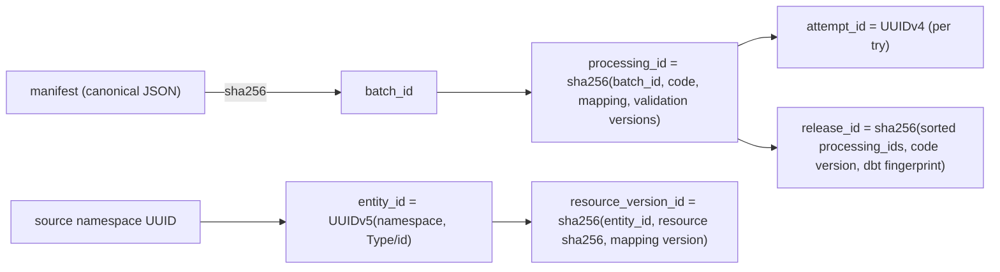
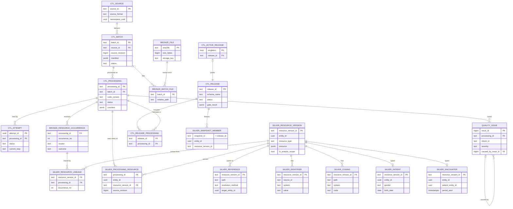

# HealthLake architecture

> HealthLake is a technical demonstration using synthetic data only.
> It is not a certified healthcare platform and is not intended or
> authorized to process real personal health data.

Six diagrams plus the entity-relationship diagram. All are Mermaid, so GitHub renders them. The overview is in the
[README](../README.md#architecture). Decisions behind these choices are in [ADRs](../architecture/adr/).

## 1. Batch lifecycle (one processing)
A **batch** is the immutable delivery (identified by the SHA-256 of its manifest). A **processing** is that batch
processed by one version of the code, mappings and validation rules. An **attempt** is one try of a processing;
several attempts may run, one at a time (advisory lock).

Exit codes from every CLI step: 0 ok, 1 unexpected, 2 contract, 3 quality, 4 transient, 5 conflict. Airflow does
not retry 2, 3 or 5. It retries 1 and 4 twice with exponential backoff.

## 2. Occurrence outcomes and the processing gate
Every resource occurrence received gets exactly one outcome, in this priority order. The counts reconcile:
`received = accepted + out_of_scope + deduplicated + rejected`.

## 3. Release lifecycle

Rebuilding the same inputs produces the same `release_id`, so the command is a no-op the second time.

## 4. Airflow DAGs

```mermaid
flowchart LR
  subgraph D["healthlake_discovery (every 5 min, max 1 active run)"]
    disc["discover"] --> trig["trigger_ingestion<br/>(mapped, one per pending batch,<br/>run_id batch__&lt;batch_id&gt;)"]
  end
  subgraph I["healthlake_ingestion (one run per batch)"]
    sa["start_attempt"] --> ve["verify"] --> ar["archive"] --> ad["adapt"] --> va["validate"] --> rr["resolve_references"]
    rr --> cq["classify_quality"] --> no["normalize"] --> ls["load_silver"] --> bs["build_snapshot"]
    bs --> db["dbt_build"] --> dd["dbt_docs"] --> qg["quality_gate"] --> pu["publish"] --> fr["final_report<br/>(ALL_DONE, only leaf)"]
  end
  trig -.-> sa
```

Ingestion tasks use the `healthlake_ingestion` pool and release tasks the `healthlake_publication` pool, one
slot each, so batches are processed one at a time and two releases never build at the same time. `final_report` always runs. It fails the DAG run unless the
attempt succeeded and its release is published, so a blocked batch shows as a failed run.

## 5. Deployment (Docker Compose)

The dashboard has no network path to PostgreSQL. The `cli` and `synthea` services sit behind the `tools`
profile and run only on demand.

## 6. Identifiers

Canonical JSON here means sorted keys, compact separators and UTF-8. It is a HealthLake convention, not RFC 8785
(JCS). See [data-contract.md](data-contract.md).

## 7. Entity-relationship diagram (control, Bronze, Silver, quality)
Gold tables are documented in [data-dictionary.md](data-dictionary.md). Typed Silver tables (`observation`,
`condition`, `medication_request`, `organization`, `practitioner`, `observation_component`,
`encounter_participant`) follow the same pattern as `patient` and `encounter`: one row per resource version.

